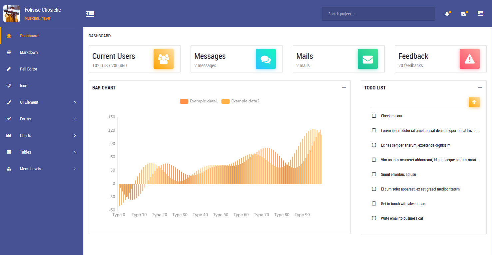
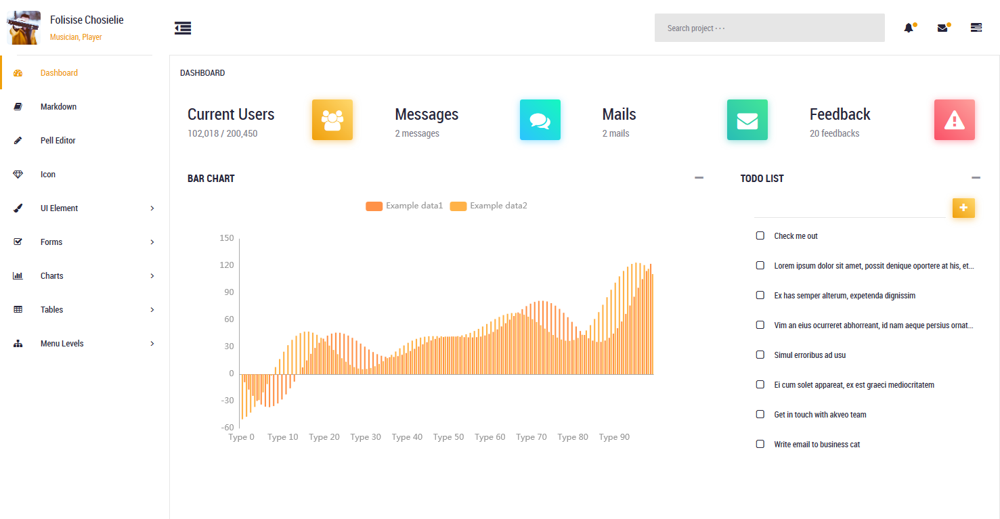
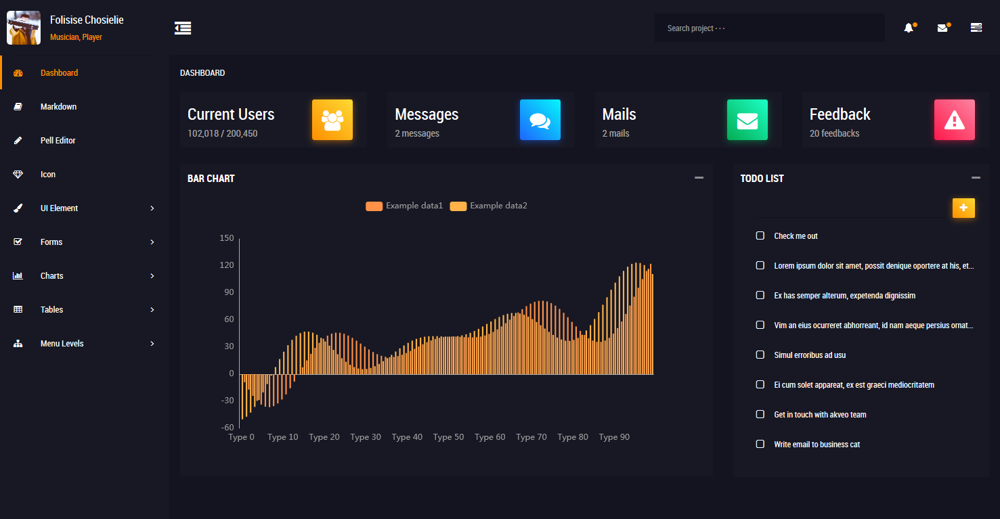

# Music School Web

A role-based **music school management platform** built with **Angular 7** — a public landing site plus authenticated dashboards for three roles (admin, instructor, student). This is earlier work (2019) and reflects my longer-standing Angular experience with feature modules, JWT auth and theming.

| Default | Light | Dark |
|---|---|---|
|  |  |  |

## What it does
- **Public landing site** — homepage and a blog/posts section (list, detail, create, manage).
- **Authentication** — JWT-based sign-in with role-aware routing (`@auth0/angular-jwt`), guarded areas per role.
- **Three role modules**, organised as separate Angular feature modules:
  - **Admin** — dashboard, manage instructors and posts, results.
  - **Instructor** — profile, course materials (file tree + uploads), students.
  - **Student** — courses, course materials, messages, results, profile.
- **Dashboards & charts** — data visualisations with ECharts (`ngx-echarts`).
- **Rich content** — WYSIWYG editing (Froala), image/file uploads, pagination, modals, carousels.
- **Theming** — selectable light / dark / default themes (see above), with SCSS and Bootstrap.

## Tech stack
Angular 7 · TypeScript · RxJS · SCSS · Bootstrap · ECharts · JWT auth · Karma/Jasmine · Protractor (e2e)

## Architecture notes
- Organised by **feature modules** (`modules/admin`, `modules/instructor`, `modules/student`, `auth`, `landing-page`) with a `shared` module for cross-cutting components, models, pipes and theming.
- Role-based access enforced through auth guards and JWT claims.
- Express server (`server.js`) serves the production build for deployment.

## Getting started
```bash
git clone https://github.com/smrafi4130/music-school-web.git
cd music-school-web
npm install
ng serve          # http://localhost:4200
```
Other scripts: `ng build --prod` (production build), `ng test` (unit), `ng e2e` (end-to-end), `ng lint`.

## Status & notes
- Built in 2019 on Angular 7; dependencies are of that era and would need upgrading to run on current tooling. It is kept as a record of earlier Angular work.
- The backend API it talks to is not part of this repository.

## License
See [LICENSE](LICENSE).
